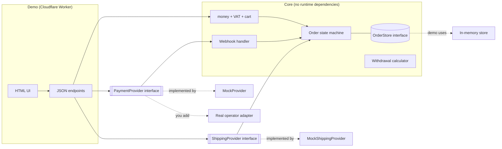
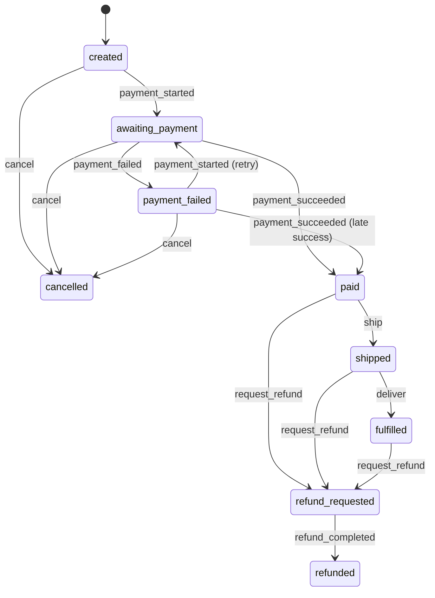

# checkout-core

A small reference implementation of the **core of a web shop checkout**: money, VAT, cart pricing, an order state machine, payment webhooks, parcel locker shipping and a withdrawal period calculator. Written in TypeScript with **zero runtime dependencies**.

The worked example is the Polish market, because that is where it was built for: BLIK, parcel lockers (paczkomaty), Polish VAT rates, the 14-day withdrawal right. The structure is not Poland-specific. Swap the data and the providers and the same core serves any market with similar needs.


## What it is for

It is a portfolio piece showing how I approach the unglamorous, expensive-to-get-wrong parts of an online shop:

- amounts that add up to the grosz, every time;
- orders that cannot jump into impossible states;
- payment notifications that arrive twice, late, out of order, or forged;
- shipping to a pickup locker with validation instead of hope.

It is a **reference for the core, not a complete shop**.

## What is inside

| Area | Where | Notes |
| --- | --- | --- |
| Money | `src/money.ts` | Integers in grosze (1 PLN = 100 grosze). No floats anywhere. |
| VAT | `src/vat.ts` | Rates 23, 8, 5, 0. Gross prices are the default source of truth. |
| Cart pricing | `src/cart.ts` | Line totals, amount and percentage discounts, delivery (flat, tiers, free above a threshold). |
| Order state machine | `src/order.ts` | Explicit transition table. Everything not listed is forbidden. |
| Payment interface | `src/payments/types.ts` | `PaymentProvider`: `createPayment`, `verifyWebhook`, `getStatus`, `refund`. |
| Mock payment operator | `src/payments/mock.ts` | Simulates BLIK, card and bank transfer. HMAC-SHA256 signed webhooks. Success, decline and delayed scenarios. |
| Webhook handling | `src/payments/webhook.ts` | Constant-time signature check, idempotency, stale event rejection. |
| Shipping interface | `src/shipping/` | `ShippingProvider`, locker code validation, parcel size classes, mock provider with label and tracking number. |
| Withdrawal period | `src/consumer-law.ts` | Last day to withdraw, 14 days by default, configurable. |
| Demo | `src/demo/`, `src/worker.ts` | Cloudflare Worker with a small UI and JSON endpoints. |

## What it deliberately does not include

- **Real payment operator adapters** (Przelewy24, PayU, Stripe and so on). I cannot verify them without sandbox accounts, and an unverified payment adapter is worse than none. See [docs/adding-a-payment-operator.md](docs/adding-a-payment-operator.md) and the clearly marked, unverified [skeleton](examples/provider-adapter.skeleton.ts).
- A real carrier integration. `MockShippingProvider` invents lockers, tracking numbers and labels.
- Product catalogue, accounts, inventory, invoices, e-mail, an admin panel, a database layer.
- Legal or tax advice (see [Limitations](#limitations)).

## Polish context, briefly

- **BLIK** is a widely used Polish mobile payment scheme. The customer generates a 6-digit code in their banking app and types it into the shop; the payment is then confirmed in the app. The mock models this: a 6-digit code, then asynchronous confirmation.
- **Parcel lockers (paczkomaty)** are self-service pickup machines run by carriers, the best known being InPost. The customer picks a locker by code at checkout. Parcels must fit the compartment size classes (commonly called A, B and C).
- **VAT** has several rates in Poland. This project supports 23% (standard), 8%, 5% and 0%. Consumer prices are shown gross, so gross is the source of truth here.
- **Withdrawal right**: consumers buying at a distance can generally withdraw within 14 days of receiving the goods. This project computes that date as data. **It is not legal advice.**

## Architecture



Order lifecycle (see the table in `src/order.ts`):



## Design decisions

**Money is an integer number of grosze.** Floats cannot represent 0.10 exactly and errors accumulate. Every function asserts safe integers and throws on anything else. Percentages are expressed in basis points (1000 = 10%), also integers.

**VAT: gross is the source of truth, rounding happens once per rate.** The customer sees and pays a gross price, so VAT is derived from it: `net = round_half_up(gross * 100 / (100 + rate))`, `vat = gross - net`. That guarantees `net + vat === gross` exactly (this is checked by a test over a range of amounts and every rate). In the summary, amounts are grouped by rate and rounded once per group rather than per line, which limits rounding error and matches the one-row-per-rate layout of an invoice. This is a design decision and not accounting advice; your accountant may want a different rule, and the rule lives in one function (`splitGross`).

**Discounts are allocated across lines with the largest remainder method**, so line discounts always sum to the total discount and each line's VAT stays consistent. A discount is capped at the goods total. Delivery is not discounted; free delivery is judged on the goods total after discount.

**The order state machine is a table, not scattered `if`s.** Every allowed transition is listed in one place. A test enumerates every state and event combination and asserts that everything not listed throws. Deliberate choices: a paid order cannot be cancelled directly, it has to go through a refund so money is never silently lost; `cancelled` and `refunded` are terminal; a late success after a reported failure is accepted, because that happens in real life (a slow banking app confirmation).

**Webhooks are treated as hostile and unreliable.**
- *Authenticity*: HMAC-SHA256 over `timestamp.rawBody`, compared in constant time, with a timestamp tolerance against replays. The signature is checked over the raw body, before parsing.
- *Idempotency*: each event has an id, stored on the order itself. Checking the id and applying the transition happen in one atomic `OrderStore.update`, so duplicate or concurrent deliveries have a single effect. A test fires five concurrent deliveries of one event.
- *Ordering*: events carry a per-payment sequence number. Older ones are ignored. Events that make no sense in the current state, for another payment id, or for the wrong amount are recorded as anomalies on the order and acknowledged, instead of throwing, so the operator stops retrying but a human can look.

**Why mocks.** A mock that behaves like a real operator (asynchronous confirmation, signed webhooks, retries, failures) lets the whole checkout be developed and tested offline and deterministically, with no accounts, keys or network. It also pins down the provider contract that a real adapter has to satisfy.

## Running it

Requires Node.js 22 or newer.

```bash
npm ci
npm test            # Vitest, runs offline
npm run typecheck   # tsc --noEmit, strict mode
npm run dev         # wrangler dev, the demo at http://localhost:8787
npm run deploy      # wrangler deploy (needs your own Cloudflare account)
```

Demo walkthrough: add products, apply a code (`SAVE10` or `MINUS20`), pick a payment method, pick a locker (for example `WAW123M`), place the order. BLIK code `222222` is declined, `333333` is delayed, other 6-digit codes succeed; bank transfer is always asynchronous. On the confirmation screen you can confirm a delayed payment, ship, mark as picked up, request a refund, and replay the last webhook to see idempotency at work.

`wrangler.jsonc` contains no account identifiers or secrets. `MOCK_WEBHOOK_SECRET` is a throwaway value that only signs fake events.

**Order state in the demo is in process memory.** It is lost on restart and is not shared between Worker isolates, so it is suitable for a demo only. I chose it over D1 to keep the demo free of setup. `OrderStore` is the seam for a real database: `update` must be an atomic read-modify-write (a transaction or an optimistic version check).

### Demo endpoints

| Method and path | Purpose |
| --- | --- |
| `GET /api/catalog` | Products, lockers, discount codes |
| `POST /api/quote` | Price a cart |
| `POST /api/orders` | Create an order and start payment |
| `GET /api/orders/:id` | Read an order |
| `POST /api/orders/:id/settle` | Resolve a delayed mock payment |
| `POST /api/orders/:id/ship`, `/deliver`, `/refund` | Move the order along |
| `POST /api/orders/:id/redeliver` | Replay the last webhook |
| `POST /api/webhooks/mock` | Signed webhook receiver |

The UI builds all dynamic content with `textContent` (never `innerHTML`, which a test checks), the Worker sends a strict Content-Security-Policy, and nothing is loaded from a CDN.

## Adding a real payment operator

Short version: implement `PaymentProvider`, translate the operator's statuses and notifications into `PaymentEvent`, and keep amounts in grosze inside the core, converting only at the adapter boundary. Full guide: [docs/adding-a-payment-operator.md](docs/adding-a-payment-operator.md). The [skeleton](examples/provider-adapter.skeleton.ts) is **unverified**: it has never been run against any operator. Production adapters need a sandbox account with the operator.

## Limitations

- **Not legal or tax advice.** The withdrawal calculator counts calendar days from the day of receipt in the Europe/Warsaw time zone and nothing more. It does not model exceptions (custom-made goods, sealed hygiene products, digital content), extended periods when information duties were not met, or a deadline that falls on a weekend or public holiday.
- VAT rates in the demo catalogue are illustrative. Correct classification of goods is your accountant's job.
- Parcel size classes, the weight limit and the locker code pattern (`WAW123M`-like) are **example values**, not verified against any carrier's specification. They are configuration; load real ones from your carrier.
- Parcel estimation in the demo is naive (one rigid box). There is no packing algorithm.
- Single currency (PLN), no multi-currency, no price-includes-tax switching per customer.
- No persistence in the demo, no authentication, no rate limiting.
- Only the mock providers have been exercised. Nothing here has been tested against a real payment operator or carrier.

## License

MIT, see [LICENSE](LICENSE).
