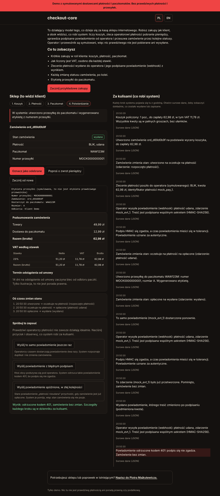
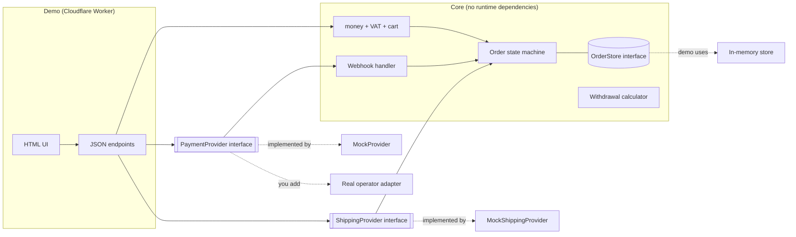
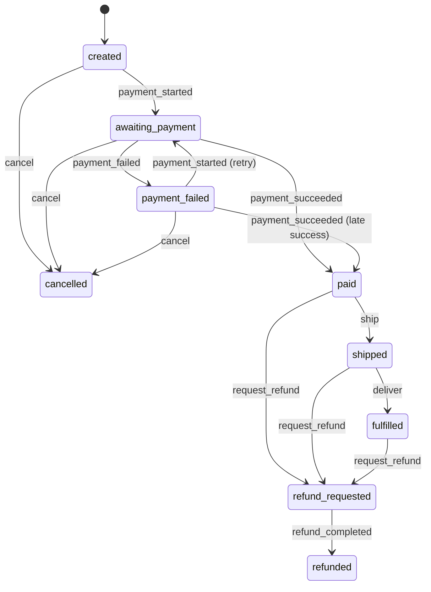

# checkout-core

A small reference implementation of the **core of a web shop checkout**: money, VAT, cart pricing, an order state machine, payment webhooks, parcel locker shipping and a withdrawal period calculator. Written in TypeScript with **zero runtime dependencies**.

The worked example is the Polish market, because that is where it was built for: BLIK, parcel lockers (paczkomaty), Polish VAT rates, the 14-day withdrawal right. The structure is not Poland-specific. Swap the data and the providers and the same core serves any market with similar needs.




## Live demo

Intended address: **https://checkout.piotrmajkutewicz.pl**. It is only live after the Worker has been deployed to that domain (see [Deploying the demo](#deploying-the-demo)); until then the link does not work. The demo uses simulated payment and parcel-locker providers: no real payments or shipments, ever. It is deliberately [not indexed by search engines](#not-indexed-on-purpose).

## Languages

The demo UI is **Polish by default**, whatever the browser's language, and can be switched to English with the PL / EN buttons in the header. The choice is remembered in `localStorage` (the page works without it), and `?lang=pl` or `?lang=en` in the address takes precedence and is saved as the choice. `<html lang>` follows the selected language.

All user-facing texts live in two dictionaries, `src/i18n/pl.ts` and `src/i18n/en.ts`; a test checks that both have the same keys, no empty texts and the same placeholders. The library core (VAT, cart, state machine, providers) contains no UI texts for the interface and does not depend on the language. The demo API returns a stable error `code` (plus a short English `error` for people reading raw JSON), and the UI translates the code. A few strings produced by the mock providers (for example the reason in a recorded webhook anomaly) stay English in the data; the UI maps them to its own texts.

Amounts are always PLN; only the conventions change with the language: Polish shows `1 234,56 zł` (non-breaking space as thousands separator, decimal comma), English shows `PLN 1,234.56`. The rule is in `src/i18n/money.ts`, and the same function runs in the browser and in the tests.

## What it is for

It is a portfolio piece showing how I approach the unglamorous, expensive-to-get-wrong parts of an online shop:

- amounts that add up to the grosz, every time;
- orders that cannot jump into impossible states;
- payment notifications that arrive twice, late, out of order, or forged;
- shipping to a pickup locker with validation instead of hope.

It is a **reference for the core, not a complete shop**.

## What is inside

| Area | Where | Notes |
| --- | --- | --- |
| Money | `src/money.ts` | Integers in grosze (1 PLN = 100 grosze). No floats anywhere. |
| VAT | `src/vat.ts` | Rates 23, 8, 5, 0. Gross prices are the default source of truth. |
| Cart pricing | `src/cart.ts` | Line totals, amount and percentage discounts, delivery (flat, tiers, free above a threshold). |
| Order state machine | `src/order.ts` | Explicit transition table. Everything not listed is forbidden. |
| Payment interface | `src/payments/types.ts` | `PaymentProvider`: `createPayment`, `verifyWebhook`, `getStatus`, `refund`. |
| Mock payment operator | `src/payments/mock.ts` | Simulates BLIK, card and bank transfer. HMAC-SHA256 signed webhooks. Success, decline and delayed scenarios. |
| Webhook handling | `src/payments/webhook.ts` | Constant-time signature check, idempotency, stale event rejection. |
| Shipping interface | `src/shipping/` | `ShippingProvider`, locker code validation, parcel size classes, mock provider with label and tracking number. |
| Withdrawal period | `src/consumer-law.ts` | Last day to withdraw, 14 days by default, configurable. |
| Demo | `src/demo/`, `src/worker.ts` | Cloudflare Worker with a small UI and JSON endpoints. |

## What it deliberately does not include

- **Real payment operator adapters** (Przelewy24, PayU, Stripe and so on). I cannot verify them without sandbox accounts, and an unverified payment adapter is worse than none. See [docs/adding-a-payment-operator.md](docs/adding-a-payment-operator.md) and the clearly marked, unverified [skeleton](examples/provider-adapter.skeleton.ts).
- A real carrier integration. `MockShippingProvider` invents lockers, tracking numbers and labels.
- Product catalogue, accounts, inventory, invoices, e-mail, an admin panel, a database layer.
- Legal or tax advice (see [Limitations](#limitations)).

## Polish context, briefly

- **BLIK** is a widely used Polish mobile payment scheme. The customer generates a 6-digit code in their banking app and types it into the shop; the payment is then confirmed in the app. The mock models this: a 6-digit code, then asynchronous confirmation.
- **Parcel lockers (paczkomaty)** are self-service pickup machines run by carriers, the best known being InPost. The customer picks a locker by code at checkout. Parcels must fit the compartment size classes (commonly called A, B and C).
- **VAT** has several rates in Poland. This project supports 23% (standard), 8%, 5% and 0%. Consumer prices are shown gross, so gross is the source of truth here.
- **Withdrawal right**: consumers buying at a distance can generally withdraw within 14 days of receiving the goods. This project computes that date as data. **It is not legal advice.**

## Architecture



Order lifecycle (see the table in `src/order.ts`):



## Design decisions

**Money is an integer number of grosze.** Floats cannot represent 0.10 exactly and errors accumulate. Every function asserts safe integers and throws on anything else. Percentages are expressed in basis points (1000 = 10%), also integers.

**VAT: gross is the source of truth, rounding happens once per rate.** The customer sees and pays a gross price, so VAT is derived from it: `net = round_half_up(gross * 100 / (100 + rate))`, `vat = gross - net`. That guarantees `net + vat === gross` exactly (this is checked by a test over a range of amounts and every rate). In the summary, amounts are grouped by rate and rounded once per group rather than per line, which limits rounding error and matches the one-row-per-rate layout of an invoice. This is a design decision and not accounting advice; your accountant may want a different rule, and the rule lives in one function (`splitGross`).

**Discounts are allocated across lines with the largest remainder method**, so line discounts always sum to the total discount and each line's VAT stays consistent. A discount is capped at the goods total. Delivery is not discounted; free delivery is judged on the goods total after discount.

**The order state machine is a table, not scattered `if`s.** Every allowed transition is listed in one place. A test enumerates every state and event combination and asserts that everything not listed throws. Deliberate choices: a paid order cannot be cancelled directly, it has to go through a refund so money is never silently lost; `cancelled` and `refunded` are terminal; a late success after a reported failure is accepted, because that happens in real life (a slow banking app confirmation).

**Webhooks are treated as hostile and unreliable.**
- *Authenticity*: HMAC-SHA256 over `timestamp.rawBody`, compared in constant time, with a timestamp tolerance against replays. The signature is checked over the raw body, before parsing.
- *Idempotency*: each event has an id, stored on the order itself. Checking the id and applying the transition happen in one atomic `OrderStore.update`, so duplicate or concurrent deliveries have a single effect. A test fires five concurrent deliveries of one event.
- *Ordering*: events carry a per-payment sequence number. Older ones are ignored. Events that make no sense in the current state, for another payment id, or for the wrong amount are recorded as anomalies on the order and acknowledged, instead of throwing, so the operator stops retrying but a human can look.

**Why mocks.** A mock that behaves like a real operator (asynchronous confirmation, signed webhooks, retries, failures) lets the whole checkout be developed and tested offline and deterministically, with no accounts, keys or network. It also pins down the provider contract that a real adapter has to satisfy.

## Running it

Requires Node.js 22 or newer.

```bash
npm ci
npm test            # Vitest, runs offline
npm run typecheck   # tsc --noEmit, strict mode
npm run dev         # wrangler dev, the demo at http://localhost:8787
npm run e2e         # Playwright checks (Polish text, mobile layout and touch scrolling), see below
npm run deploy      # wrangler deploy (needs your own Cloudflare account)
```

Demo walkthrough: the page has an intro, then two columns. On the left is the shop as a customer sees it (cart, payment, parcel locker, confirmation); on the right, "Behind the scenes" is a timestamped log of what the system does: cart pricing and VAT, the payment order sent to the (simulated) operator, the signed webhook with its HMAC verification, every order status change and the shipment label. Each entry can be expanded to its raw JSON. On a phone the two columns become two tabs.

Simulated payments, all through `MockProvider` with no network access:

- **BLIK**: `111111` is declined, `222222` stays pending for a few seconds (a countdown, then the confirmation webhook arrives), any other 6-digit code succeeds. The demo selects the mock operator's scenario explicitly, so the core's own test codes (`222222`, `333333` in `MockProvider`) are not used by the UI.
- **Card**: a form with Luhn validation that accepts only three made-up test numbers: `4242 4242 4242 4242` succeeds, `4000 0000 0000 0002` is declined, `4000 0000 0000 3220` opens a simulated 3-D Secure screen (approve or reject). The browser sends only the chosen scenario to the demo API; the number never leaves the page.
- **Bank transfer**: a simulated bank screen; after you confirm, the webhook arrives a moment later.

After a purchase, three buttons show the reliability guarantees, with the result visible in the log: send the same webhook again (duplicate, order unchanged), send one with a wrong signature (rejected with 401), send a late out-of-order "payment failed" notice (ignored, state unchanged). The order summary has a VAT table per rate, delivery, discount, the withdrawal period (illustration, not legal advice), the parcel label and a status timeline.

`wrangler.jsonc` contains no account identifiers or secrets. `MOCK_WEBHOOK_SECRET` is a throwaway value that only signs fake events.

**Order state in the demo is in process memory.** It is lost on restart and is not shared between Worker isolates, so it is suitable for a demo only. I chose it over D1 to keep the demo free of setup. `OrderStore` is the seam for a real database: `update` must be an atomic read-modify-write (a transaction or an optimistic version check).

### Deploying the demo

The public demo is the same Worker as `npm run dev`, with a custom domain and a rate limit configured in `wrangler.jsonc`.

1. `npx wrangler login` (opens the browser; no token goes into the repo).
2. The domain's zone (`piotrmajkutewicz.pl`) must be on the same Cloudflare account.
3. `npm run deploy`. Because `wrangler.jsonc` has `"routes": [{ "pattern": "checkout.piotrmajkutewicz.pl", "custom_domain": true }]`, wrangler creates the DNS record and certificate for that hostname on deploy. If a DNS record for that name already exists, remove it first.
4. The `ratelimits` entry gives the Worker a per-IP limit of 120 requests per minute (a full walk through the demo, with the reliability buttons, takes well under 50 requests, and each request is cheap and memory-capped) (`namespace_id` is just a number you pick, not an account identifier). Without the binding, for example under `vitest`, the Worker falls back to a small in-memory limiter with the same numbers.
5. Optional, extra layer: a WAF rate limiting rule for `checkout.piotrmajkutewicz.pl` in the Cloudflare dashboard (Security, WAF, Rate limiting rules). It stops abusive traffic before it reaches the Worker. Which options are available depends on your plan.

Public-demo safeguards in the code: at most 200 orders (and mock payments) are kept in memory, the oldest are dropped; request bodies over 4 KB are refused with 413; every input is validated strictly (unknown fields, wrong types and duplicate cart lines are rejected); error responses carry fixed messages only, never stack traces or echoed input; and the providers are mocks that never open a network connection, so nothing in the demo can reach a real payment or shipping service.

### Not indexed on purpose

Every response carries `X-Robots-Tag: noindex, nofollow` and the page has `<meta name="robots" content="noindex, nofollow">`. `/robots.txt` allows everything on purpose: if crawling were disallowed, search engines could not read the `noindex` and might still list the bare URL. There is no sitemap.

### Loading states and motion

Every action that makes a request (placing the order, confirming a 3-D Secure or bank step, shipping, refund, the three reliability buttons, "Start over") switches its button to a "Processing..." state with a CSS spinner immediately, ignores further clicks until the answer arrives, and keeps the button's width so nothing jumps. Re-pricing the cart dims the totals card with a small spinner instead of changing its size. Waiting for a simulated BLIK confirmation, a bank transfer or a 3-D Secure decision shows a loader with a countdown or a status line; a successful payment draws an SVG tick, a declined one shakes once and shows a plain message. New entries in the "Behind the scenes" log slide in and the newest one is highlighted briefly (the page scroll is never moved), the step pills transition smoothly and the order status badge pops when it changes. A visually hidden `role="status"` region announces busy states and status changes in the selected language. With `prefers-reduced-motion: reduce` all animations and transitions are switched off (the spinner stays as a static marker next to its text). No libraries or external resources are involved; the Content-Security-Policy is unchanged.

### End-to-end checks

`npm run e2e` starts `wrangler dev` on port 8941 (or uses `E2E_BASE_URL`) and drives the UI with Playwright (browsers need to be installed: `npx playwright install chromium`). It walks the whole path in Polish and fails if any visible text or accessible name contains typical English words (a short list of deliberate exceptions such as BLIK, JSON, HMAC, 3-D Secure, webhook, VAT is stripped first), it also checks that each request-backed button shows its loading state within 100 ms, ignores double clicks and keeps its width, that reduced motion switches animations off, and, on an iPhone 13 profile, it checks on every step that the page is not wider than the screen, that real touch swipes scroll down and back up, that re-rendering does not move the scroll position and that touch targets are at least 44 px.

### Demo endpoints

| Method and path | Purpose |
| --- | --- |
| `GET /api/catalog` | Products, lockers, discount codes |
| `POST /api/quote` | Price a cart |
| `POST /api/orders` | Create an order and start payment |
| `GET /api/orders/:id` | Read an order |
| `POST /api/orders/:id/settle` | Resolve a pending mock payment (`{"outcome":"succeeded"\|"failed"}`) |
| `POST /api/orders/:id/ship`, `/deliver`, `/refund` | Move the order along |
| `POST /api/orders/:id/redeliver` | Replay the last webhook (duplicate) |
| `POST /api/orders/:id/forge` | Send the last webhook with a changed body and the old signature (401) |
| `POST /api/orders/:id/late` | Send a genuine but outdated "payment failed" event (ignored) |
| `POST /api/webhooks/mock` | Signed webhook receiver |

The UI builds all dynamic content with `textContent` (never `innerHTML`, which a test checks), the Worker sends a strict Content-Security-Policy, and nothing is loaded from a CDN.

### Deploying from GitHub Actions

The repository includes a manual workflow (`.github/workflows/deploy.yml`). Add two repository secrets (Settings, Secrets and variables, Actions): `CLOUDFLARE_API_TOKEN` (a token with permission to edit Workers and the DNS zone of the domain) and `CLOUDFLARE_ACCOUNT_ID`. Then run Actions, Deploy, Run workflow on `main`. The workflow runs the type check and the tests first.

## Adding a real payment operator

Short version: implement `PaymentProvider`, translate the operator's statuses and notifications into `PaymentEvent`, and keep amounts in grosze inside the core, converting only at the adapter boundary. Full guide: [docs/adding-a-payment-operator.md](docs/adding-a-payment-operator.md). The [skeleton](examples/provider-adapter.skeleton.ts) is **unverified**: it has never been run against any operator. Production adapters need a sandbox account with the operator.

## Limitations

- **Not legal or tax advice.** The withdrawal calculator counts calendar days from the day of receipt in the Europe/Warsaw time zone and nothing more. It does not model exceptions (custom-made goods, sealed hygiene products, digital content), extended periods when information duties were not met, or a deadline that falls on a weekend or public holiday.
- VAT rates in the demo catalogue are illustrative. Correct classification of goods is your accountant's job.
- Parcel size classes, the weight limit and the locker code pattern (`WAW123M`-like) are **example values**, not verified against any carrier's specification. They are configuration; load real ones from your carrier.
- Parcel estimation in the demo is naive (one rigid box). There is no packing algorithm.
- Single currency (PLN), no multi-currency, no price-includes-tax switching per customer.
- No persistence in the demo and no authentication. The only abuse protection is the per-IP rate limit and the memory caps described above.
- Only the mock providers have been exercised. Nothing here has been verified against a real payment operator or carrier, and none of the operators or carriers named in this README have been tested.

## License

MIT, see [LICENSE](LICENSE).
